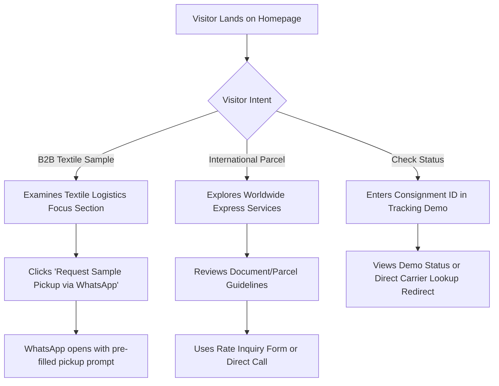

# Product Requirements Document (PRD)

**Project:** Economic Courier / eCS World Wide Express Website  
**Location:** Bhilwara, Rajasthan, India  
**Document Version:** 1.0  
**Status:** Approved for Implementation Planning  

---

## 1. Executive Summary & Product Vision

### 1.1 Vision
To establish an authoritative, modern, and trustworthy digital presence for **Economic Courier / eCS World Wide Express** in Bhilwara. The website will position the business as the premier logistics partner for Bhilwara’s thriving textile sector, industrial enterprises, and retail citizens requiring dependable domestic express and international air cargo services.

### 1.2 Core Objectives
1. **Client Proposal Asset:** Function as an exceptional portfolio and pitch artifact to present to the business owner, proving immediate value.
2. **Local Market Positioning:** Differentiate eCS Economic Courier from commodity courier desks through superior visual prestige, service clarity, and textile logistics focus.
3. **Frictionless Lead Capture:** Convert casual visitors into high-intent courier bookings and inquiries via WhatsApp, direct call triggers, and structured rate inquiry workflows.
4. **Transparent Tracking Demo:** Provide an intuitive consignment tracking interface that demonstrates digital competence without falsely simulating live carrier integrations.

---

## 2. Target Audiences & User Personas

### 2.1 Persona A: Textile Sample Coordinator (Primary B2B)
- **Profile:** Mill owner, textile agent, or merchandiser in Bhilwara (e.g., RIICO Industrial Area or Pur Road).
- **Need:** Daily express dispatch of fabric swatches, yarn samples, and catalogs to garment exporters in Mumbai, Surat, Delhi, or international buying houses in Europe and the US.
- **Pain Points:** Missed delivery deadlines leading to canceled purchase orders, lack of dedicated pickup, opaque tracking.
- **User Goal:** Rapidly confirm sample delivery timelines, verify international capabilities, and initiate immediate courier pickup via WhatsApp or telephone.

### 2.2 Persona B: Individual & Student Senders (Retail / B2C)
- **Profile:** Local Bhilwara resident sending legal paperwork, university application transcripts to the USA/UK/Canada, or festival sweets/gifts to family across India.
- **Need:** Trustworthy counter service, clear customs guidance for overseas parcels, safe packaging assurance.
- **Pain Points:** Anxiety over lost international documents, confusion regarding prohibited items or paperwork.
- **User Goal:** Verify office location, operating hours, package rates, and international transit reliability.

### 2.3 Persona C: Corporate & Industrial Office Manager (B2B Accounts)
- **Profile:** Accounts or supply chain head at a Bhilwara manufacturing facility, heavy machinery distributor, or commercial firm.
- **Need:** Monthly billing, bulk consignment handling, express air cargo, proof of delivery (POD).
- **Pain Points:** Inconsistent customer service, lack of single point of contact for corporate accounts.
- **User Goal:** Contact business management to discuss contracted courier services and volume rates.

---

## 3. Key User Journeys

---

## 4. Page Scope & Functional Architecture

### Phase 1 Scope: High-Impact Master Home Page
The initial client pitch delivers an expansive, polished single-page master experience containing:
1. **Header & Navigation:** Dual-branding logo (eCS / Economic Courier), quick links, office hours badge, emergency dispatch phone, and WhatsApp CTA.
2. **Hero Section:** Value proposition headline, high-speed delivery badges, quick-action tracking simulator input, and direct booking triggers.
3. **Bhilwara Textile Specialization Strip:** Highlighted capability on textile sample logistics, rapid swatch delivery to major trade corridors.
4. **Comprehensive Services Matrix:**
   - Domestic Express (Overnight & Air Cargo)
   - Worldwide Express (International documents & air parcels)
   - Textile & Industrial Logistics (Sample swatch dispatch, B2B parcel handling)
   - Secure Document Courier (Legal, educational, passport transit)
5. **Interactive Consignment Tracking Interface (Demo Mode):** Clear demo disclaimer, sample consignment lookup, and direct carrier portal routing.
6. **Local Advantage & Trust Credentials:** Bhilwara locality focus, packaging expertise, doorstep pickup highlights.
7. **Transparent Rate & Service Inquiry:** Clean form allowing destination, approximate weight, and package type input (dispatches via structured WhatsApp message or mailto).
8. **Contact & Location Hub:** Address placeholder, interactive map placeholder, phone/email, office timings.
9. **Footer:** Quick navigation, service areas, legal disclaimers, and local copyright.

### Phase 2 Scope: Multi-Page Expansion (Post-Client Sign-Off)
- `/services` — Detailed breakdown with packaging requirements and destination lists.
- `/about` — Heritage of Economic Courier in Bhilwara, mission, and fleet overview.
- `/rates` — Comprehensive weight calculator and zone reference guide.
- `/track` — Dedicated tracking portal with carrier API integration or routing matrix.
- `/contact` — Comprehensive branch locator and corporate inquiry desk.

---

## 5. Functional & Non-Functional Requirements

### 5.1 Functional Requirements
- **FR-01 (WhatsApp Lead Engine):** One-click button generating pre-formatted WhatsApp chat (`https://wa.me/91XXXXXXXXXX?text=Hi%20Economic%20Courier...`).
- **FR-02 (Tracking Simulator):** Accepts consignment input; provides structured feedback for sample numbers (`ECS-BHL-1001`), and explicitly informs user that live real-time API integration activates upon client rollout.
- **FR-03 (Service Filter):** Interactive tab selector to toggle between Domestic, International, and Textile Sample requirements.
- **FR-04 (Quick Rate Inquiry):** Client-side calculator allowing users to select Domestic/International, enter weight estimate, and generate a customized WhatsApp quote request.
- **FR-05 (Direct Click-to-Call):** Mobile telephone link (`tel:`) styled as persistent emergency contact on mobile viewports.

### 5.2 Non-Functional Requirements
- **NFR-01 (Performance):** Google Lighthouse Performance score $\ge 90$ on both mobile and desktop.
- **NFR-02 (Accessibility):** WCAG 2.1 AA compliance across all components, contrast ratios, and keyboard focus states.
- **NFR-03 (Responsiveness):** Seamless layout adaptation across viewports: Mobile (360px–420px), Tablet (768px), Laptop (1024px), Desktop (1440px+).
- **NFR-04 (SEO):** Targeted for local Bhilwara search intent (`courier in Bhilwara`, `express parcel Bhilwara`, `international courier service Bhilwara`).
- **NFR-05 (Integrity):** Zero deceptive UI states; clear notices on all mock capabilities.

---

## 6. Acceptance Criteria for Client Presentation

1. **Brand First Impression:** The page loads in under 1.5 seconds on 4G networks with zero cumulative layout shift (CLS < 0.05).
2. **Visual Differentiation:** The site looks like an elite logistics brand—not a generic template.
3. **Local Relevance:** Prominently features Bhilwara and textile industry terminology.
4. **Action-Oriented:** Every section has clear call-to-action paths directly connecting to the courier desk.
5. **Transparency Check:** All unverified figures and mock tracking elements display clean, professional disclosure notes.
